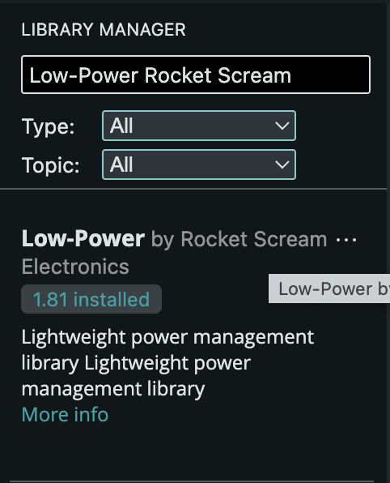
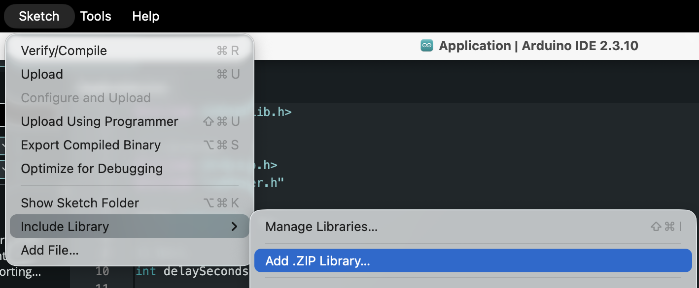
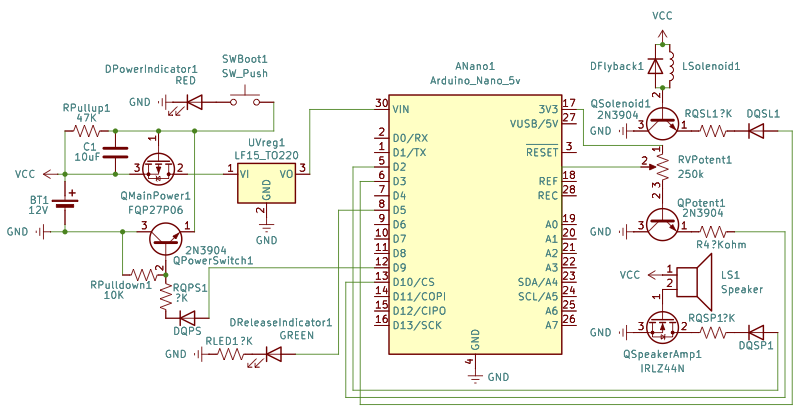

# Red Wolf Feeder

## Disclaimer!
**This project is meant to function semi-autonomously with human input only necessary through the physical interface panel on the device. It is not typically necessary to change the code in this repository.**

## Reasons for use
One of the main reasons you may want to adjust the code is to test if the delay configuration dial is working correctly or adjust the range of values it chooses from. Follow the instructions below to set up the IDE, run the debugging code, update the settings, and reupload the code. If you simply want to update the settings, you can skip running the debugging code.

## Setup
### 1. Download the project

1. Open the [EGR101 repository](https://github.com/BrendanO123/EGR101).
2. Select **Code**, then **Download ZIP**.
3. Extract the ZIP file somewhere easy to find.

### 2. Install Arduino IDE and Libraries

1. Download and install the [Arduino IDE](https://www.arduino.cc/en/software).
2. Open the [Application.ino](src/main/Application/Application.ino) file from **File > Open**
3. Open Arduino IDE and install the **Low-Power** library from **Tools > Manage Libraries** (or **Sketch > Include Library > Manage Libraries**, depending on your IDE version). Search for `Low-Power` and install the library by ***Rocket Scream*** (this is very important to check the author here as there is a library by nearly the exact same name by Arduino that does not work with this device). See below:

   

4. Take the EGR101Lib folder and compress into to a `.zip` file
5. Open the Arduino IDE app and find the "Add .ZIP Library" button, typically located at **Sketch > Include Library > Add .ZIP Library** and then select the zip of the EGR101Lib folder

    

### 3. Select the Board and Port

1. Open the Boards Manager from the side bar or **Tools > Board > Board Manager** and search for **Arduino AVR Boards** and click install
2. Go to either **Tools > Board > Arduino AVR Boards** or the board and port drop down in the top left and search for **Arduino Nano**
3. Go to the device and remove the screw panel over the electronics and plug into the micro-controller
4. Ensure the port is set to USB Serial through either the same board and port drop down as step 2 or **Tools > Port**
5. Press the upload button in the top left corner (second button from the left in below)

    

6. You should see a message that the code compiles and uploads correctly. You can now open whichever sketch you want and upload, but ensure you upload the [main Application](src/main/Application/Application.ino) last if you upload other code. If you get a not found or not defined error on the `#include` statements or variables, try reimporting the libraries with steps 3 and 5 of the [previous section](ReadME.md#2-install-arduino-ide-and-libraries).

## Summary on Uploading Code:

1. In Arduino IDE, choose **File > Open** and open the `.ino` file you want.
2. Connect the Arduino Nano with the USB cable.
3. From **Tools > Board**, select **Arduino AVR Boards > Arduino Nano**.
5. From **Tools > Port**, select **USB Serial**.
6. Select **Upload** (the right-arrow button) and wait for Arduino IDE to report that the upload is complete.

## Using the Delay Debug Code
This project comes with another `.ino` file in addition to the main application found at [src/main/DelayDebug/DelayDebug.ino](src/main/DelayDebug/DelayDebug.ino). This is used to give a live readout of the values the code understands the delay dial to be representing depending on the settings and the angle of the dial. These settings are found [here](src/main/EGR101Lib/Settings.h), and will need you to repeat steps 4 and 5 of [section two](ReadME.md#2-install-arduino-ide-and-libraries) as well as reupload the code as described [above](ReadME.md#summary-on-uploading-code)
## 4. Check the delay dial

1. Open and upload `src/main/DelayDebug/DelayDebug.ino` as described above.
2. Open **Tools > Serial Monitor**.
3. Set the Serial Monitor baud rate to **9600**.
4. Turn the delay dial and watch the voltage and delay number update.

## 5. Change project settings

Open [`Settings.h`](src/main/EGR101Lib/Settings.h) in Arduino IDE or a text editor. Change the values, save the file, repeat steps 4 and 5 of [section two](ReadME.md#2-install-arduino-ide-and-libraries) to reimport the library then upload the [Application](src/main/Application/Application.ino) again. The values to look for are the minimum and maximum delay (`minDelaySeconds`, `maxDelaySeconds`) and the delay dial's calibration voltages (`potentMinV`, `potentMaxV`), as well as, to a lesser extent, the duration and frequency of the noise played (`soundDurationMillis`, `soundFrequency`) and the active duration for the solenoid during release (`releaseDurationMillis`).

Only change the calibration voltages if you the minimum and maximum delay printed out by the `delayDebug.ino` sketch does not line up with the minimum and maximum delay configured in the file.

All though it is very much advised against changing you can also find the pin assignments in [`EGR101Lib.h`](src/main/EGR101Lib/EGR101Lib.h) if you end up altering the wiring of the circuit itself.

## Circuit schematic

